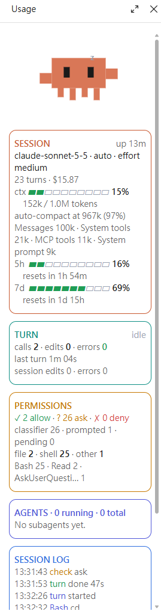
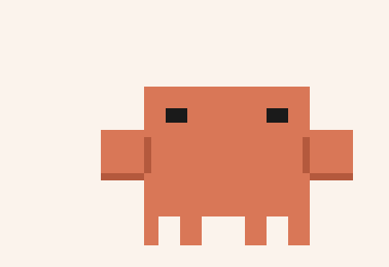
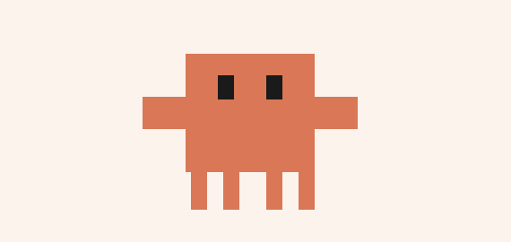
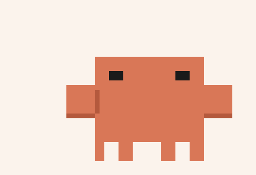
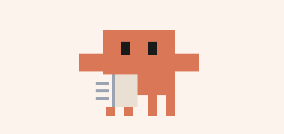
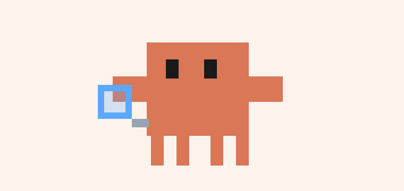

<p align="center"></p>

<h1 align="center">ClaudeCode_Dashboard</h1>

English · [繁體中文](README.zh-TW.md)

<p align="center"></p>

A resource monitor for Claude Code on desktop. It lives in a side pane and shows live usage, context, permissions and subagents without leaving the app. It only observes events: no model calls, zero tokens, and it never blocks or rewrites tool calls.

### Mascot

<table><tr><td align="center"><br><sub>Idle: sleeps, looks around, winks</sub></td><td align="center"><br><sub>Takes out a laptop and types</sub></td><td align="center"><br><sub>Watching the laptop screen</sub></td></tr><tr><td align="center"><br><sub>Pacing while thinking</sub></td><td align="center"><br><sub>Hopping</sub></td><td align="center"><br><sub>Reading</sub></td></tr><tr><td align="center"><br><sub>Searching</sub></td><td align="center"><br><sub>Idea</sub></td><td align="center"><br><sub>Coffee break</sub></td></tr></table>

### Features

- **Plan limits**: 5-hour and 7-day usage bars with reset countdowns.
- **Session**: model, permission mode, effort, turn count, cost, uptime, context bar, auto-compact threshold and the largest context categories.
- **Turn**: live turn timer, tool calls, edits, errors, last turn duration, session totals.
- **Permissions**: allow / ask / deny counts, file / shell / other split, top tools.
- **Subagents**: one card each with name, description, status, elapsed time, output tokens and model.
- **Session log**: the last 12 events (tools, permissions, turns, subagents).
- **Animated mascot**: the Claude mascot, animated: it sleeps and looks around when idle, and while Claude works it rotates through using a laptop, reading, searching, having coffee, pacing, getting ideas and hopping. A spinner marks the running turn and live subagents. Drawn as SVG on desktop, text fallback elsewhere.
- **Reopenable**: the `Usage ▸` button above the prompt brings the pane back after closing it.
- Works in light and dark mode, text wraps in a narrow pane.

### Install

Plugin name: `claudecode-dashboard`.

```
claude plugin marketplace add <path-or-repo>
claude plugin install claudecode-dashboard@local-mods --scope user
```

Then run `/reload-plugins`. Desktop surface is the target; other surfaces get the text fallback.

### What the hooks do

All hooks only observe and always pass the event through unchanged: `tool.check` records the allow / ask / deny verdict (it awaits the verdict and returns it as given), `tool.call` counts calls and errors, `turn.start` / `turn.complete` time turns and read subagent output tokens, `classic.*` events record permission mode, effort and permission dialogs, `session.*` start the refresh timer, and `ui.render` draws the pane and the `Usage ▸` button.

### Limits

Not exposed by the API, so not shown: per-subagent context size, the classifier's real verdict, a request count (turn count is used instead). "Pending" counts asked calls that have not finished, including the tool's own run time.
