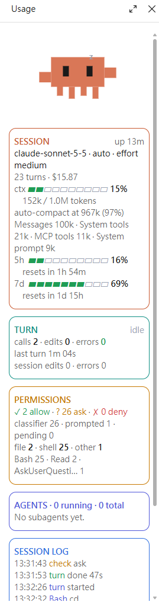

<p align="center"></p>

<h1 align="center">ClaudeCode_Dashboard</h1>

[English](README.md) · 繁體中文

<p align="center"></p>

Claude Code 桌面版的資源監視器。放在側邊面板，不離開 app 就能即時看用量、context、權限和 subagent。只觀察事件：不呼叫模型、不耗 token，也不阻擋或改寫工具呼叫。

### 吉祥物

<table><tr><td align="center"><br><sub>閒置：睡覺、東張西望、眨眼</sub></td><td align="center"><br><sub>拿出筆電、轉身打字</sub></td><td align="center"><br><sub>盯著筆電螢幕</sub></td></tr><tr><td align="center"><br><sub>邊走邊想</sub></td><td align="center"><br><sub>跳躍</sub></td><td align="center"><br><sub>看書</sub></td></tr><tr><td align="center"><br><sub>搜尋</sub></td><td align="center"><br><sub>靈光一閃</sub></td><td align="center"><br><sub>喝咖啡休息</sub></td></tr></table>

### 功能

- **方案用量**：5 小時與 7 天用量條，附重置倒數。
- **Session**：模型、權限模式、effort、回合數、費用、運行時間、context 條、自動壓縮門檻、佔用最多的 context 類別。
- **Turn**：本回合即時計時、工具呼叫數、編輯數、錯誤數、上一回合耗時、整個 session 累計。
- **Permissions**：允許 / 詢問 / 拒絕次數、檔案 / shell / 其他分類、前幾名工具。
- **Subagents**：每個一張卡，顯示名稱、說明、狀態、經過時間、輸出 token 與模型。
- **Session log**：最近 12 筆事件（工具、權限、回合、subagent）。
- **會動的吉祥物**：Claude 吉祥物動畫：閒置時睡覺、東張西望，Claude 工作時輪流表演用筆電、看書、搜尋、喝咖啡、踱步、靈光一閃和跳躍。進行中的回合和 subagent 前有轉動的 spinner。桌面版用 SVG 繪製，其他環境退回文字版。
- **可重開**：關掉面板後，用輸入框上方的 `Usage ▸` 按鈕重新打開。
- 淺色與深色模式都可讀，窄面板文字會自動換行。

### 安裝

外掛名稱：`claudecode-dashboard`。

```
claude plugin marketplace add <路徑或 repo>
claude plugin install claudecode-dashboard@local-mods --scope user
```

之後執行 `/reload-plugins`。以桌面版為主，其他環境使用文字版吉祥物。

### Hook 做了什麼

所有 hook 都只觀察，並原封不動放行事件：`tool.check` 記錄允許 / 詢問 / 拒絕的判定（先取得判定結果再原樣回傳），`tool.call` 統計呼叫與錯誤，`turn.start` / `turn.complete` 計時回合並讀取 subagent 輸出 token，`classic.*` 事件記錄權限模式、effort 與權限彈窗，`session.*` 啟動更新計時器，`ui.render` 繪製面板和 `Usage ▸` 按鈕。

### 限制

API 拿不到所以不顯示：每個 subagent 的 context 大小、分類器的真正判定、請求數（以回合數代替）。「等待」是判為詢問但尚未結束的呼叫數，包含工具本身執行的時間。
